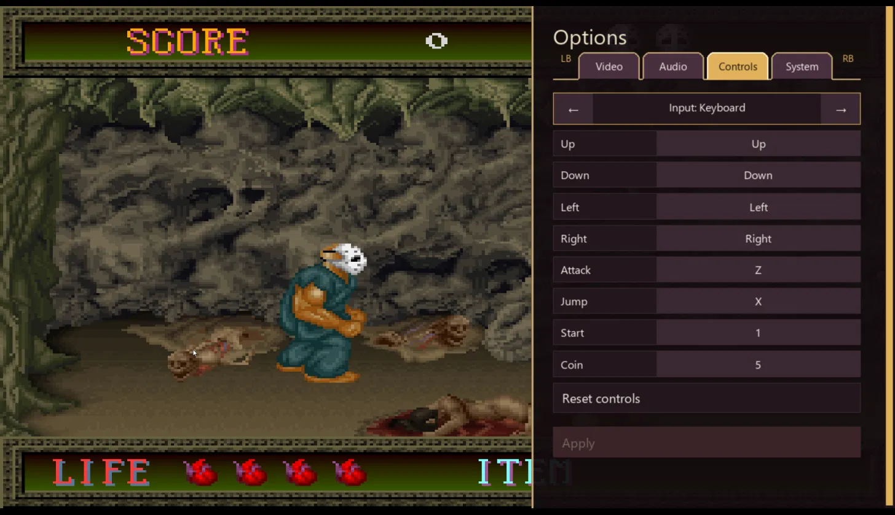
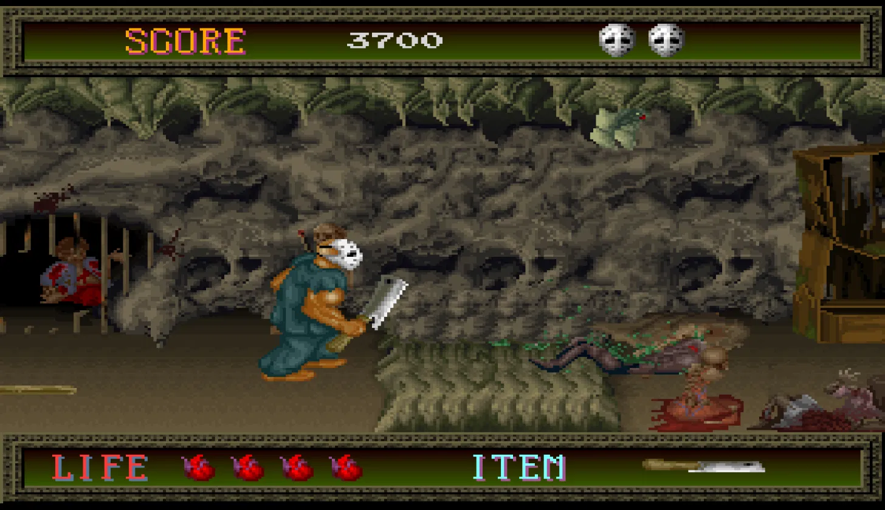
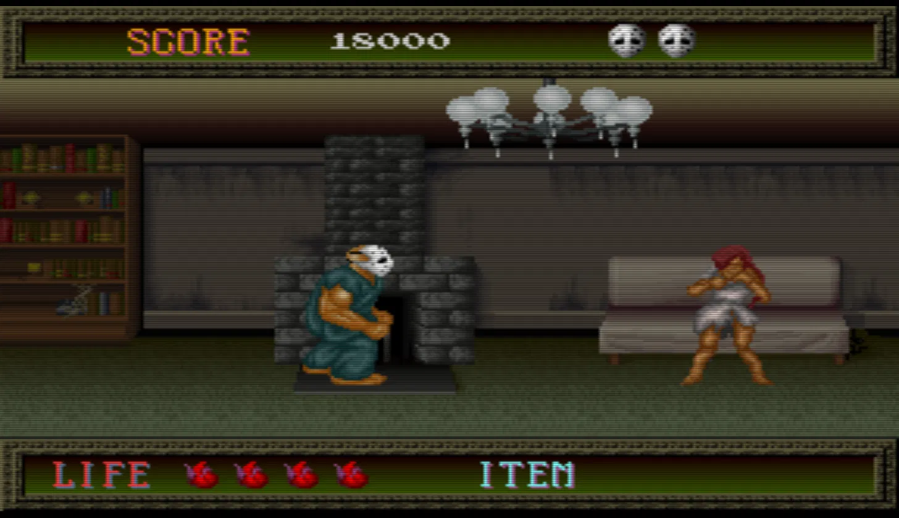
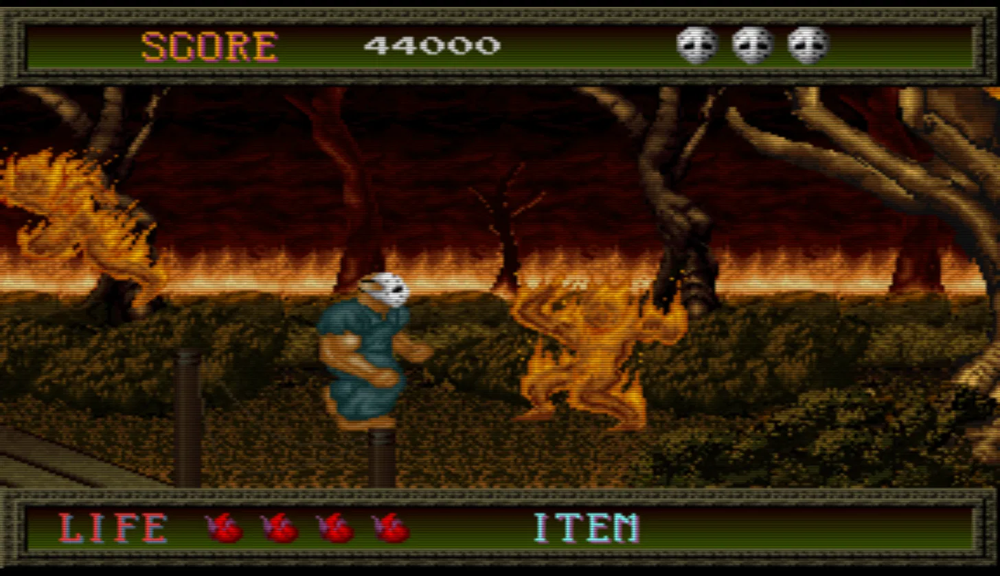

# Splatterhouse (Arcade) — native PC port

Dedicated Namco System 1 runtime for **Splatterhouse (1988)**.
Bring your own MAME romset (`splatter.zip`). No game code or assets are shipped.

This is **not** the Xbox 360 (2010) recomp. It targets the arcade board.

## Screenshots

<p align="center">
  
  
</p>
<p align="center">
  
  
</p>

## How to play

1. Download a [GitHub Release](https://github.com/gabo-mdev/sh-arcade-recomp/releases).
2. Put your MAME `splatter.zip` (World / SH3) next to the executable, or pass its path.
3. Run the game. Escape opens in-game options; language defaults to English (Spanish available).

## Player quick start (Windows x64)

1. Grab a release zip (or build from source below).
2. Put your MAME romset next to `splatterhouse.exe` as `splatter.zip`
   (World / SH3). Clones `splatter2.zip` / `splatterj.zip` are not supported yet.
3. Run `splatterhouse.exe`.

On first launch the exe extracts and maps the romset into a local `rom/`
folder. Later launches reuse that folder.

You can also pass a path:

```text
splatterhouse.exe path\to\splatter.zip
splatterhouse.exe path\to\extracted-mame-folder
splatterhouse.exe path\to\prepared\rom
splatterhouse.exe --prepare path\to\splatter.zip
```

Escape opens the options menu (language: English default, Spanish available).
The **debug panel** (stage select, fast boot, invincible, untouchable) is off
by default: set `debug_menu=1` in `options.cfg`, then press **F1** (or R3 on a
gamepad). Unlock FPS and mono stay in Escape options. Full list:
[debug menu](docs/08-debug-menu.md).

Linux x64 builds are experimental (same flags; binary name `splatterhouse`).

## Status

**Playable end-to-end** on the dedicated NS1 runtime (interpreters): bring your
own MAME romset, Coin/Start, full stages. Host options (Escape, EN/ES) and an
optional debug panel (F1; see [docs/08-debug-menu.md](docs/08-debug-menu.md))
are in.

Still open on the hybrid plan:

1. MAME oracle polish (remaining pixel/audio diffs) — see
   [video roadmap](docs/05-video-roadmap.md) and [audio SFX](docs/07-audio-sfx.md)
2. Static recompilation of 6809 code → C
3. Later: presentation options + OST replacement hooks

## Known issues

- **Fire Dead SFX delay.** The Fire Dead death/voice sample can start late
  relative to the on-screen hit. The cue shares the MCU voice mailbox with
  other DAC one-shots, so commands can queue and play behind the animation.
  Tracking notes: [audio SFX](docs/07-audio-sfx.md).

## Requirements (players)

- Windows 10/11 x64 (primary); Linux x64 experimental
- Your own MAME Splatterhouse romset (`splatter.zip`, World / SH3)

## Requirements (developers)

- Windows 10/11 x64 or Linux x64
- CMake 3.25+, Ninja, Clang or MSVC (C++20)
- Python 3.10+ (optional; only for the legacy `tools/extract_rom.py` helper)
- SDL3 (fetched via CMake `FetchContent`)
- Optional: MAME ~0.287+ for oracle traces

## Build from source

### Windows

```powershell
# Optional: pre-build rom/ with the Python helper (the exe can also do this)
python tools/extract_rom.py splatter.zip

# Build (sets up MSVC INCLUDE/LIB + Ninja; SDL window ON by default)
.\build.ps1

.\build\splatterhouse.exe
# Smoke test only (no window): run 5 frames with null backends, then exit
.\build\splatterhouse.exe --headless --frames 5
```

If you call `cmake`/`ninja` by hand, use an **x64 Native Tools / Developer PowerShell for VS**
prompt. A normal PowerShell lacks MSVC include paths (`cstdint` not found).

### Linux

```bash
cmake -S . -B build -G Ninja -DCMAKE_BUILD_TYPE=Release -DSH_HOST_SDL=ON
cmake --build build --parallel
./build/splatterhouse
# Smoke test only (no window): run 5 frames with null backends, then exit
./build/splatterhouse --headless --frames 5
```

On Debian/Ubuntu you typically need packages for SDL’s video/audio backends, e.g.
`ninja-build`, `cmake`, `pkg-config`, X11/Wayland/ALSA/Pulse/udev development
headers, plus `libfontconfig-dev` so the Escape menu picks a system sans-serif
on any distro. CI installs a known set in `.github/workflows/release.yml`.

### Recomp / analysis scaffolding

```powershell
python tools/analyze.py      # -> analysis/static.json
python tools/transpile.py    # -> src/gen/main_recomp.cpp (gitignored)
```

## Releases

Tag `v*` (for example `v0.1.0`) to run GitHub Actions. Artifacts use the repo
codename (not the game title):

- `sh-arcade-recomp-v*-windows-x64.zip`
- `sh-arcade-recomp-v*-linux-x64.tar.gz` (experimental)

Local packing:

```powershell
.\tools\pack_release.ps1 -Version 0.1.0
```

```bash
./tools/pack_release.sh 0.1.0
```

## Layout

```
rom/          # gitignored — prepared romset (auto-built next to the exe)
docs/         # hardware notes, verification, host debug menu
tools/        # extract, analyze, transpile, MAME Lua, diffs, pack scripts
src/
  cpu/        # MC6809E + HD63701
  bus/        # CUS117 + virtual address decode
  video/      # tilemaps / sprites / palette
  audio/      # YM2151 + Namco WSG + DAC
  host/       # present + audio backends (SDL / null)
  machine/    # runtime + ROM prepare/load
  gen/        # generated recomp output (gitignored)
tests/
```

## Legal

Splatterhouse © Namco. This repository contains **no** ROM data and does not
redistribute generated game code. Use only a romset you are entitled to use.

Runtime, tools, and docs: MIT — see [LICENSE](LICENSE).
